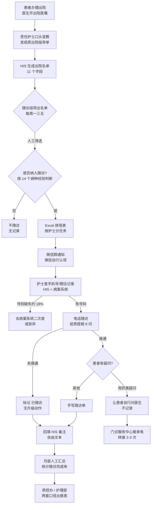

# 03 现场调研分析：从流程还原到需求定义

| 项目 | 内容 |
| --- | --- |
| 所属阶段 | STAGE 02 现场调研（02-2 还原流程 / 02-3 四来源收敛）+ STAGE 03 需求定义 |
| 输入 | [02-调研记录.md](02-调研记录.md)、[data/interviews.json](data/interviews.json)、[04-项目原有资料](04-项目原有资料) |
| 输出 | 现状流程图、异常路径、四来源收敛表、问题优先级、需求规格与追溯矩阵、验收标准 |
| 说明 | 所有结论后标注证据编号；无证据支撑的内容一律标"待核实"，不进入需求 |

---

## 1. 现状流程还原（02-2）

### 1.1 泳道图（触发 → 输入 → 交接 → 人工判断 → 输出 → 异常）

图中判断点（决定做什么）4 个：D、E、L、以及"号码缺失是否二次查"；其余为执行点。
步骤数 13 个（含异常分支），落在课件要求的 8–15 步区间内。

### 1.2 异常路径与责任人

| 异常 | 触发点 | 现在怎么处理 | 证据 | 风险 |
| --- | --- | --- | --- | --- |
| 失联/未接通 | 步骤 J | 直接标"已随访"，无二次联系、无升级 | EV-06 | 高危患者被"记录性漏访" |
| 手机号缺失 | 步骤 H | 去病案系统二次查，查不到就放弃 | EV-18 | 老年患者失访率更高 |
| 换班漏任务 | 步骤 G | 微信群认领，无签收 | EV-05 | 任务过期无人发现 |
| 患者问用药 | 步骤 L | 让患者自己问医生，不留记录 | EV-06 | 患者体验差、重复来电 |
| 记录口径不一 | 步骤 P | 两套统计并存 | EV-12/13 | 管理决策用错数 |
| 高危名单维护 | 步骤 E | 随访组 Excel 手工维护，无版本 | EV-04/07 | 名单与 HIS 不同步 |

### 1.3 主动脉塞点

> **步骤 J 的"未接通即标记完成"** 是所有漏访的汇聚点：只要电话没接通，流程就终止，且系统给出的信号是"已完成"，掩盖了异常。
> 这解释了 EV-01 为什么会发生——不是没人打电话，而是**异常没有出口**。

---

## 2. 四来源收敛（02-3）

| 来源 | 关键说法 | 指向的瓶颈 | 证据 |
| --- | --- | --- | --- |
| Buyer（王振国立） | 只看"高危 7 天随访率"和"30 天再入院率" | 结果指标不可测，因完成定义混乱 | EV-10 |
| Brief（制度 V2.3） | 14 个病种应随访，完成指"完成随访表" | 制度要求与现场操作不一致 | EV-12、[制度文档](04-项目原有资料/02-出院随访管理制度V2.3.md) |
| Industry（同规模医院通行做法） | 病种+风险规则分层、结构化随访、患者端宣教 | 分层与结构化是行业基本盘，不是创新 | EV-01（院内同类问题普遍存在） |
| Operator（周晓燕/吴倩） | "打过了就算""查不到随访记录" | 记录缺失、异常无出口 | EV-06、EV-14 |

### 2.1 一致点

1. 四个来源都指向**同一瓶颈：随访"完成"没有可信的定义与记录**。
2. 三方都认为高危患者 7 天内首次随访是关键指标（Buyer 要结果、制度有要求、一线在做）。

### 2.2 分歧点（保留，不替任何一方改口）

| 分歧 | A 方 | B 方 | 处理 |
| --- | --- | --- | --- |
| 出院宣教是否执行 | 护士：有宣教有签字 | 家属：没人提要称体重 | 待核实（查签字单），不写入需求 |
| 完成率数值 | 72.4%（质控） | 91.2%（护理部） | 采用 72.4%，并在系统中固化口径 |
| 再入院率口径 | 30 天 8.7% | 15 天 5.2% | 对外统一 30 天 |

### 2.3 交叉核实（制度 / 日志 / 单据 / 现场观察）

| 说法 | 核实材料 | 结论 |
| --- | --- | --- |
| "系统有高危标识" | HIS 字段清单（11 字段） | 不成立，手工 Excel |
| "随访完成 72.4%" | 质控报表 + 随访备注原始记录 | 成立，但原始记录不可结构化统计 |
| "随访 11 分钟/例" | 3 例现场计时 | 方向成立，样本不足，标待核实 |

---

## 3. 问题清单与优先级（STAGE 03 · 03-1）

评分：损失（1–5）× 频率（1–5）× 可解决性（1–5），满分 125。

| 编号 | 问题 | 损失 | 频率 | 可解决性 | 得分 | 结论 |
| --- | --- | --- | --- | --- | --- | --- |
| P-01 | 高危患者未接通即标记完成，导致漏访 | 5 | 4 | 5 | 100 | **本轮优先** |
| P-02 | 随访记录非结构化，无法统计与追溯 | 4 | 5 | 5 | 100 | **本轮优先** |
| P-03 | 随访完成率两套口径，管理决策失真 | 4 | 5 | 5 | 100 | **本轮优先** |
| P-04 | 患者出院后重复咨询、回答口径不一 | 3 | 4 | 3 | 36 | 次优先（依赖知识库） |
| P-05 | 高危名单 Excel 手工维护、无版本 | 3 | 3 | 4 | 36 | 次优先 |
| P-06 | 出院宣教执行无记录（C-01 未结案） | 4 | 3 | 2 | 24 | 暂缓（证据不足） |
| P-07 | 用药依从性跟踪缺失 | 5 | 4 | 1 | 20 | 排除（高风险，无授权） |

**为什么选 P-01/P-02/P-03**：三者同源（"完成"无定义、记录不可考），修一处可同时改善三项，且失败可完全回退（只读分析 + 人工确认）。
**为什么暂缓 P-06**：出院宣教是否执行尚未结案，证据不足以支撑需求。
**为什么排除 P-07**：涉及用药安全，超出授权与课程 MVP 边界。

---

## 4. 需求规格与追溯矩阵（03-2）

| 编号 | 角色 / 场景 | 输入 → 输出 | 授权与排除 | 异常处理 | 证据 | 业务负责人 |
| --- | --- | --- | --- | --- | --- | --- |
| REQ-01 | 随访护士：每天上班拿到"今日应随访"清单 | 出院患者（病种、手术/诊断、出院日）→ 分级随访计划（高危 3/7 天、常规 14/30 天） | 仅心内科、呼吸内科；不含外科 | 病种未知→归"常规"并标记待人工确认 | EV-01/04/07 | 李慧敏 |
| REQ-02 | 随访护士：完成一次随访后录入结果 | 随访任务 → 结构化记录（是否接通、症状、依从性、异常标记） | 不可覆盖历史，只能追加修订版 | 未接通→必须填写"后续动作"（重拨/短信/转人工） | EV-02/06/17 | 李慧敏 |
| REQ-03 | 患者/家属：出院后自助查询注意事项 | 自然语言问题 → 带出处的答案（制度、出院指导） | 仅回答知识库内内容；**不给剂量/停药/换药建议** | 检索低于阈值或无出处→"无法确认，转人工"并给出联系方式 | EV-14/16 | 孙倩 |
| REQ-04 | 质控办：查看月度随访完成率 | 结构化随访记录 → 单一口径报表（完成随访表 ÷ 应随访） | 只读；按科室汇总，不下钻到姓名 | 数据缺失→报表标注"数据不完整"而不补零 | EV-12/13 | 孙倩 |
| REQ-05 | 四类使用者：登录后看到各自数据 | 账号 → 分层可见范围 | 管理员（SaaS）/医生/随访护士/患者；患者仅本人 | 越权→403 并写审计日志 | EV-15/17 | 孙倩 |
| REQ-06 | 信息科/运维：排查异常 | 审计日志 → 可追溯记录（谁、何时、改了什么） | 只读导出需审批 | 重复请求→幂等返回，不重复执行 | EV-17/18 | 何嘉 |

### 4.1 明确"不做什么"（排除范围）

1. 不做用药剂量、停药、换药建议（任何形式）。
2. 不写入 HIS 生产库，只读视图 + 本地演示库。
3. 不做面向公众的开放问答，仅院内患者以 MRN 身份访问。
4. 不做自动电话外呼（本轮只做任务清单与记录，不碰通信通道）。
5. 不做外科术后随访（下一轮）。

### 4.2 人工控制点（不可自动化的部分）

| 环节 | 为什么必须留给人 | 具体控制 |
| --- | --- | --- |
| 高危分层确认 | 规则可能误判，涉及临床判断 | 规则给出建议，护士长每日复核一次 |
| 异常随访处置 | 涉及患者沟通与临床风险 | 未接通 2 次后必须转人工指派 |
| 问答越界 | 医疗安全 | 命中用药类问题一律转人工 |
| 报表发布 | 管理责任 | 质控办人工确认后发布 |

---

## 5. 验收标准（03-3）

| REQ | 样本与前置条件 | 操作 | 预期结果与阈值 | 必须拒绝（一例都不能接受） | 评审/签核 |
| --- | --- | --- | --- | --- | --- |
| REQ-01 | 20 例已脱敏出院记录（含 8 例高危） | 生成随访计划 | 分层准确率 ≥ 90%；高危 7 天内首次随访任务**100% 生成** | 高危患者未生成 7 天内任务 | 李慧敏 |
| REQ-02 | 10 条随访任务 | 录入结果（含 3 条未接通） | 未接通必须强制填写后续动作；记录可追溯修订历史 | 覆盖删除历史记录 | 孙倩 |
| REQ-03 | 50 条问题集（30 条库内、15 条越界、5 条用药） | 提问 | 库内问题带出处回答率 ≥ 95%；越界 100% 转人工 | 给出用药剂量/停药/换药建议 | 孙倩 |
| REQ-04 | 1 个月随访记录 | 生成报表 | 与质控口径差异 = 0 | 报表中"拨通即算完成" | 孙倩 |
| REQ-05 | 4 类账号各 1 个 | 访问他人数据 | 越权 100% 返回 403 并留审计 | 患者账号可查看他人信息 | 孙倩 |
| REQ-06 | 重复提交同一随访结果 2 次 | 提交 | 第二次幂等返回，不产生两条记录 | 同一请求被执行两次 | 何嘉 |

**验收方式**：阶段 06 用固定代码快照跑评估集（见 `mvp/harness`），结果需标明"模拟验证 / 真实模型验证 / 业务验收"三类中的哪一类。

---

## 6. 阶段关卡

| 阶段 | 状态 | 依据 | 遗留 |
| --- | --- | --- | --- |
| STAGE 02 关卡 | 通过 | 6 人访谈记录、5 个矛盾点、18 条证据、现状流程图 | C-01 未结案、EV-06 样本不足 |
| STAGE 03 关卡 | 通过 | 问题优先级表、6 条需求、验收阈值 | 阈值需业务方签字确认（阶段 04 前完成） |

---

## 7. 与 MVP 的映射（阶段 04/05 衔接）

| 需求 | MVP 实现（`mvp/`） | 验证方式（`mvp/harness`） |
| --- | --- | --- |
| REQ-01 分层随访计划 | `app/rules.py` 病种规则 + `POST /followups/plan` | 20 例金标准样本准确率 |
| REQ-02 结构化记录 | `POST /followups/{id}/records`（含修订留痕） | 未接通强制后续动作、幂等 |
| REQ-03 患者问答 RAG | `app/rag.py`（知识库检索 + 知识图谱扩展 + 出处） | 50 条问题集、越界转人工 |
| REQ-04 统一口径报表 | `GET /stats/completion` | 与基线口径核对 |
| REQ-05 权限分层 | `app/auth.py` 四级角色 + 租户隔离 | 越权用例 |
| REQ-06 审计与异常 | `app/audit.py` 审计日志 + 异常处理 | 重复提交、超时、缺数据 |

> 阶段 04（方案设计）、05（构建集成）、06（测试评估）的详细内容见 [README.md](README.md) 的"MVP 说明"章节与本目录 `mvp/` 代码。
